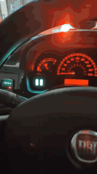
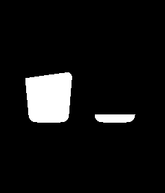
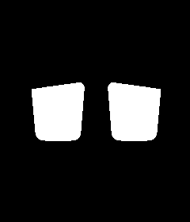
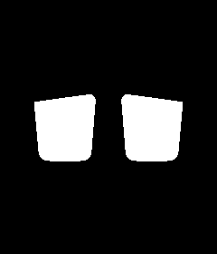

  

  <h3>Hardware &amp; Software R&amp;D Developer</h3>

  
I design the board, write the firmware, and build the app that talks to it.

## About

I work in hardware and software R&D at **Startit Srl**: custom hardware,
firmware, and the software around it, from embedded devices and industrial
protocols to web backends and interactive interfaces.

Working on both hardware and software means I have no one else to blame.

In 2017, I built OtaBot, a WhatsApp chatbot powered by Google Dialogflow.
It only spoke Italian and was slow even in that language. It's now shut down,
but the name lived on in [OTA-Bot-Mochi](https://github.com/camiu01/OTA-Bot-Mochi),
which actually works. My code has improved since then. Probably.

## Featured: OTA-Bot-Mochi

  
  

  
  
  
  
  

An ESP32-S3 desktop companion with **254 animated expressions**, touch and motion
reactions, a clock, Pomodoro timers, Pong, and phone notifications, weather, and
navigation over BLE. Runs on LCD and AMOLED boards, and ships with a desktop
emulator and native tests.

**[View the repository →](https://github.com/camiu01/OTA-Bot-Mochi)**

## Other projects

| Project | What it is | Stack |
| :--- | :--- | :--- |
| [TraceLink](https://github.com/camiu01/TraceLink) | ESP32 monitor for RS232, RS485, and CAN traffic, with a web dashboard and an optional MCP bridge. | C++, PlatformIO, JS |
| [Haguruma](https://github.com/camiu01/Haguruma) · [live ↗](https://camiu01.github.io/Haguruma/) | Drivetrain simulator: gear ratios, shift points, tractive force. | TypeScript, Vite |
| [BenchCore](https://github.com/camiu01/BenchCore) · [site ↗](https://benchcore-ten.vercel.app) | Self-hosted publishing platform for engineering notes. | SvelteKit, PostgreSQL |
| [PolySheet](https://github.com/camiu01/PolySheet) · [live ↗](https://camiu01.github.io/PolySheet/) | Offline tabletop RPG character sheets, dice, and combat. | TypeScript, Vite |
| [YAPBPS](https://github.com/camiu01/YAPBPS) | Parametric enclosure for DC-DC bench power supplies. | OpenSCAD |
| [Omnistand](https://github.com/camiu01/Omnistand) | Parametric 3D-printable stand for handheld consoles. | OpenSCAD |

[All repositories →](https://github.com/camiu01?tab=repositories)

## Technologies

    
   
    

Also worked with: Swift/SwiftUI, Kotlin, Java, Unity/C# (XR).

## Contact

For technical questions or collaboration, contact me on
[Telegram](https://t.me/CAMIU).

For bugs and project-specific suggestions, open an issue
in the relevant repository.

  <picture>
    <source
      media="(prefers-color-scheme: dark)"
      srcset="https://raw.githubusercontent.com/camiu01/camiu01/output/github-contribution-grid-snake-dark.svg"
    />
    <source
      media="(prefers-color-scheme: light)"
      srcset="https://raw.githubusercontent.com/camiu01/camiu01/output/github-contribution-grid-snake.svg"
    />
    
  </picture>

  

